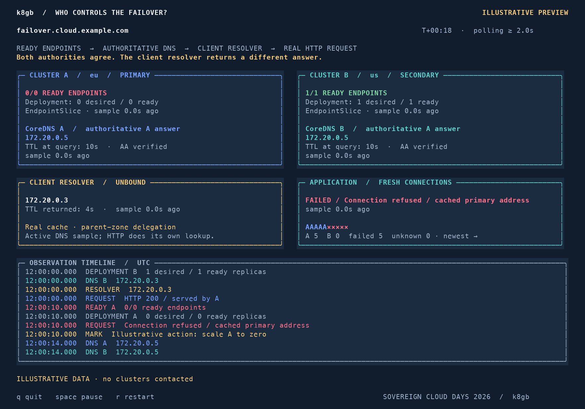

# k8gb — Sovereign Cloud Days 2026

**Who Controls the Failover? Sovereign Global Traffic Management with Kubernetes**  
Yury Tsarev · 24 October 2026 · Saarbrücken

Final presentation and terminal demo for Kubernetes traffic steering across independent clusters.

- [PowerPoint — 34 slides](slides/k8gb_sovereign_cloud_days_2026.pptx)
- [PDF](slides/k8gb_sovereign_cloud_days_2026_preview.pdf)
- [CLI demo and setup](demo/README.md)
- [Demo runbook](demo/RUNBOOK.md) and [validation status](demo/VALIDATION.md)

The PowerPoint includes speaker notes. The PDF is a preview rendered from the saved presentation; native PowerPoint rendering remains unverified.

## Try the demo preview

```bash
python3 demo/dashboard.py --preview
```

Use a terminal around 132 columns × 44 rows. Python 3.9+ with curses is sufficient on macOS/Linux; the preview needs no pip dependencies. Press `q` to quit.



The preview uses clearly labelled illustrative data. Live mode observes two application clusters, their CoreDNS authorities, a local BIND9 parent, a caching resolver, and HTTP responses. It requires the upstream k8gb playground described in the [runbook](demo/RUNBOOK.md). Live integration has not yet been rehearsed.

## Project and contact

- [k8gb.io](https://www.k8gb.io/)
- [k8gb source](https://github.com/k8gb-io/k8gb)
- [Yury Tsarev on LinkedIn](https://www.linkedin.com/in/yurytsarev/)
- [Millennium bcp case study](https://www.cncf.io/case-studies/millennium-bcp/)

