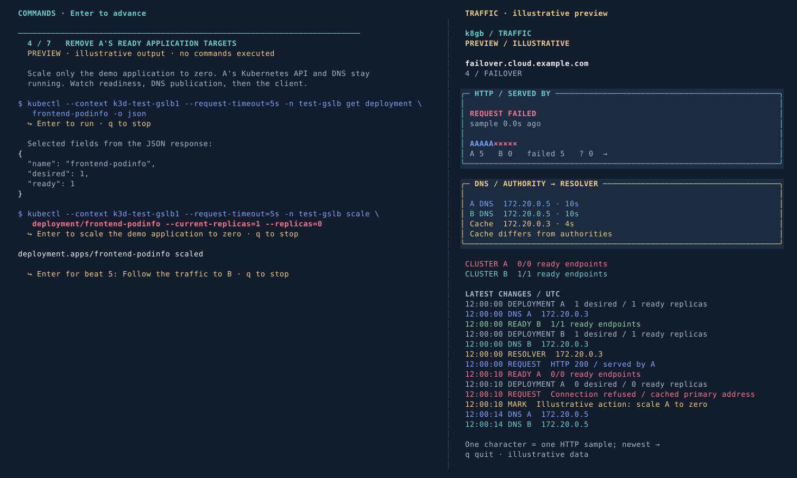

# k8gb — Sovereign Cloud Days 2026

**Who Controls the Failover? Sovereign Global Traffic Management with Kubernetes**  
Yury Tsarev · 24 October 2026 · Saarbrücken

Final presentation and terminal demo for Kubernetes traffic steering across independent clusters.

- [PowerPoint — 20 main slides + 6 hidden appendix slides](slides/k8gb_sovereign_cloud_days_2026.pptx)
- [PDF](slides/k8gb_sovereign_cloud_days_2026_preview.pdf)
- [CLI demo and setup](demo/README.md)
- [Demo runbook](demo/RUNBOOK.md) and [validation status](demo/VALIDATION.md)

The PowerPoint includes speaker notes. The PDF is a preview rendered from the saved presentation; native PowerPoint rendering remains unverified.

## Presentation pacing

The prepared talk targets **28 minutes**, leaving **7 minutes for questions** within 35 minutes.

| Segment | Slides | Time |
| --- | --- | --- |
| k8gb capabilities and architecture | 1–12 | 12 min |
| Local CLI demonstration | 13 | 6 min |
| Operational hard parts | 14–18 | 8 min |
| Closing | 19 | 2 min |
| Questions | 20 | 7 min |

Speaker notes include the elapsed-time target for every main slide. The demo now precedes the DNS timing, application readiness, partition, and observability discussion. Readiness and the failed-payment example share one slide; the node/zone/cluster progression also shares one slide.

The components slide follows the main architecture diagram. Slide 11 covers native Kubernetes resource integrations and DNS provider choices, based on the [resource reference documentation](https://www.k8gb.io/master/resource_ref/) and [DNS integration guides](https://www.k8gb.io/master/tutorials/). The PowerPoint has six hidden appendix slides after Questions, numbered A1–A6 (physical slides 21–26): reconciliation, delegation, normal operation, failover, failback, and availability responsibilities. They are skipped during the normal slideshow and available for questions. The PDF includes these reference pages and bookmarks after the 20 main slides.

## Try the demo preview

```bash
./demo/demo.sh stage --preview
```

Use a terminal around 160 columns × 44 rows, Python 3.9+, and tmux. Press Enter in the left pane to advance through visible commands and short notes; the right pane follows traffic, DNS, and readiness. The preview needs no Kubernetes cluster or pip dependencies.



The preview uses clearly labelled illustrative data. For the real local demo, start Docker and run:

```bash
./demo/demo.sh up
```

This provisions the clusters, local BIND9, k8gb, and observer; checks real DNS and HTTP traffic; then opens the Enter-driven presentation with recording. `./demo/demo.sh rehearse` runs and records the complete A → B → A sequence automatically. See [prerequisites and setup](demo/README.md#run-the-real-demo) and the [runbook](demo/RUNBOOK.md).

## Offline fallback with Enter

```bash
./demo/demo.sh offline
```

Plays a bundled real rehearsal: captured commands and highlighted YAML on the left, synchronized recorded traffic on the right. Press Enter to advance; the recorded clock pauses while you explain. Both panes say **RECORDED REPLAY**. Only Python 3.9+ and tmux are needed; no Docker, Kubernetes, kubeconfig, network, or pip packages. The displayed commands are never executed. See [recording provenance](demo/fallback/README.md).

## Project and contact

- [k8gb.io](https://www.k8gb.io/)
- [k8gb source](https://github.com/k8gb-io/k8gb)
- [Yury Tsarev on LinkedIn](https://www.linkedin.com/in/yurytsarev/)
- [Millennium bcp case study](https://www.cncf.io/case-studies/millennium-bcp/)

